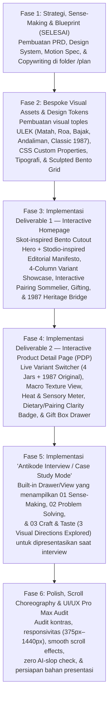

# 00 — Master Execution Plan: ULEK Launch Website (Antikode Skill Test)

## 1. Tujuan Akhir Proyek (North Star Goal)

Membangun **Interactive Launch Website (HTML/CSS/JS)** untuk **ULEK (Brief C)** yang melampaui ekspektasi tim penguji **Antikode** pada ketiga dimensi penilaian:
1. **01. Sense-making:** Membuktikan ketajaman membaca masalah tersembunyi di dalam brief (lonjakan harga Rp25.000 ke Rp100.000, menjaga hati pelanggan setia Warung Sidoarjo 1987, menjembatani keahlian ulek Jawa Timur ke 4 pulau Nusantara, serta transparansi *pairing* kuliner & informasi halal/nabati pada varian *Andaliman — "With grilled pork, noodles"* untuk audiens *food gifting*).
2. **02. Problem solving:** Menerjemahkan setiap temuan di atas menjadi fitur dan struktur halaman yang nyata di **Homepage** dan **Product Detail Page (PDP)**—bukan sekadar hiasan visual.
3. **03. Craft & taste:** Menghadirkan kualitas *Art Direction* dan *UI/UX Pro Max* yang memadukan kemewahan bentuk **Bento Sculpted Cutout (`Skot.` reference)** dengan ritme kontras **Editorial Dark/Light (`Stodio®` reference)** serta tipografi serif berkarakter dari **Brief C Antikode**, ditambah dokumentasi **3 Eksplorasi Arah Visual (Visual Range)** yang siap dipresentasikan saat interview.

---

## 2. Arsitektur Direktori Proyek (`/Users/ibnusoffyantsauri/Documents/GitHub/Ulek`)

```text
Ulek/
├── AGENTS.md                                      # Guardrails utama untuk AI Coding Agent
├── README.md                                      # Dokumentasi proyek & panduan menjalankan/presentasi
├── plan/                                          # Direktori Master Plan & Spesifikasi Lengkap
│   ├── 00_MASTER_EXECUTION_PLAN.md                # Roadmap eksekusi end-to-end (Dokumen ini)
│   ├── 01_PRD_ULEK_LAUNCH_WEBSITE.md              # Product Requirements Document (PRD) & Scope Boundaries
│   ├── 02_DESIGN_SYSTEM_AND_ANTI_SLOP_GUIDE.md    # Design System, Bedah 2 Referensi Visual, & Anti-AI-Slop
│   ├── 03_INTERACTION_AND_MOTION_SPEC.md          # Spesifikasi Scroll Effects, Micro-interactions, & State
│   ├── 04_COPYWRITING_AND_CONTENT_DECK.md         # Copywriting Kata-per-Kata, Data Produk, & Naskah Interview
│   └── references/                                # Screenshot Brief Asli & Referensi Moodboard
│       ├── 01_antikode_brief_c_ulek.png
│       ├── 02_antikode_assessment_criteria.png
│       ├── 03_mood_ref_skot_bento_hero.png
│       └── 04_mood_ref_stodio_editorial_rhythm.png
└── (Tahap Coding Berikutnya)
    ├── index.html                                 # Interactive Launch Website (Homepage + PDP + Case Study Mode)
    ├── css/
    │   └── styles.css                             # Custom CSS Tokens, Bento Cutouts, & Scroll Animations
    ├── js/
    │   ├── data.js                                # Canonical Data Store (4 Reserve Jars + 1987 Classic + Stockists)
    │   └── app.js                                 # Interactive State, Variant Switcher, Pairing Sommelier, & Cart/Gift
    └── assets/                                    # Bespoke Product Visuals, SVG Illustrations, & Editorial Imagery
```

---

## 3. Fase Eksekusi Bertahap (Step-by-Step Roadmap)



### Detail Tiap Fase & *Definition of Done (DoD)*

#### Fase 1: Strategi, Sense-Making & Blueprint (`./plan/`) — **[CURRENT PHASE]**
* **Output:** Seluruh dokumen panduan di dalam folder `plan/` selesai ditulis secara presisi.
* **DoD:** Tidak ada ambiguitas sedikit pun tentang fitur apa yang boleh dan tidak boleh dibuat, palet warna apa yang dipakai, dan bagaimana kedua gambar referensi (`Skot.` & `Stodio®`) diterjemahkan ke dalam konteks brand sambal **ULEK**.

#### Fase 2: Bespoke Visual Assets & Foundation Tokens
* **Output:**
  * Pembuatan aset visual produk beresolusi tinggi untuk ke-4 varian **Reserve Line (Rp100.000)**: *Matah (Bali)*, *Roa (Manado)*, *Bajak (Jawa)*, *Andaliman (Batak)*, serta **Toples Klasik Sidoarjo 1987 (Rp25.000)**—lengkap dengan pencahayaan studio hangat dan tekstur bahan baku (*lemongrass/shallot*, *smoked roa fish*, *caramelized chili/garlic*, *green Batak peppercorn*).
  * Setup fondasi CSS variabel warna, skala tipografi, serta *custom SVG icons* (tanpa emoji sama sekali).
* **DoD:** Semua aset gambar tampil tajam, menggugah selera makan (*high appetite appeal*), dan memiliki rasio kontras yang teruji.

#### Fase 3: Implementasi Deliverable 1 — Interactive Homepage
* **Output:** Halaman utama peluncuran yang menggabungkan anatomi terbaik dari referensi:
  1. **Floating Pill Navigation (`Skot.` style):** Logo `ULEK.` di tengah/kiri, tautan cepat (`The Reserve Line`, `Pairing Guide`, `Gift Box`, `1987 Original Rp25k`), tombol `Interview Case Study`, dan `Pantry Bag (0)`.
  2. **Sculpted Bento Cutout Hero (`Skot.` style):** Headline berani dengan *inline badge pills*, visual toples utama yang menembus batas *container* (*out-of-bounds product break*), *notched bottom-left cutout card* yang menjelaskan varian aktif, serta *floating bottom-right switcher* untuk mengganti varian di Hero secara *real-time*.
  3. **Editorial Manifesto & Two-Tone Scroll Text (`Stodio®` style):** Kicker kotak merah `[■] SIDOARJO, 1987 — GENERATION III`, diikuti kalimat manifesto dua warna (*black + warm muted stone*) yang menyala bertahap saat di-*scroll*.
  4. **The 4 Artisanal Reserve Collection (`Stodio®` 4-Column Portrait Cards):** Menampilkan **Matah**, **Roa**, **Bajak**, dan **Andaliman** dalam *vertical portrait cards* dengan *hover state* interaktif, indikator *Heat (`2/5`, `3/5`, `2/5`, `4/5`)*, asal daerah, *food pairing*, dan tombol inspeksi ke PDP.
  5. **"What's on Your Plate Tonight?" Interactive Pairing Sommelier:** Pengunjung memilih hidangan (*Grilled Fish*, *Rice & Eggs*, *Tempe & Fried Chicken*, *Grilled Pork / Noodles*) untuk melihat rekomendasi sambal dan profil kimianya.
  6. **"By The Numbers" Heritage & Craft Metrics (`Stodio®` Dotted Grid):** Menampilkan angka kunci (`1987`, `3rd Gen`, `4 Islands`, `Rp25k & Rp100k`) dengan garis titik-titik khas Swiss editorial.
  7. **The "Nice Pantry" & Custom Gift Box Builder:** Menjawab kebutuhan audiens baru usia 25–40 tahun yang suka memberi hadiah makanan (*food gifting*) dengan fitur pilih isi *box*, kartu ucapan, dan kejelasan label komposisi/halal.
  8. **The 1987 Sidoarjo Original Bridge (Rp25.000):** Seksi khusus berlatar hangat/kontras yang memastikan pelanggan lama tidak merasa ditinggalkan—lengkap dengan opsi beli langsung toples klasik Rp25.000.

#### Fase 4: Implementasi Deliverable 2 — Interactive Product Detail Page (PDP)
* **Output:** Halaman detail produk yang komprehensif dan interaktif:
  1. **Instant Variant Switcher Bar:** Bisa berganti antara *Matah*, *Roa*, *Bajak*, *Andaliman*, maupun melihat perbandingan dengan *1987 Original* secara instan.
  2. **Sculpted Dual-Column Showcase:** Kiri menampilkan galeri toples + *Macro Spoon Texture View* (melihat ulekan kasar cabai & minyak rempah); Kanan menampilkan informasi harga (`Rp100.000`), asal daerah, **Calibrated Heat Meter (`2/5` s.d. `4/5`)**, dan **Tasting Notes**.
  3. **Culinary Pairing & Dietary Transparency Callout:** Menjelaskan rekomendasi hidangan sesuai brief (*With grilled fish*, *With rice and eggs*, *With tempe, fried chicken*, *With grilled pork, noodles*) sekaligus memberikan informasi transparan mengenai bahan dasar toples (penting untuk *Andaliman* dan pembeli *gifting*).
  4. **Purchase Mode Toggle:** Beli satuan (*Single Jar — Rp100.000*), *Send as a Gift (+ Gift Wrap & Custom Message)*, atau *The Discovery Quartet (4 Jars — Rp380.000 / Rp400.000)*.
  5. **Provenance, Storage & Comparison Matrix:** Tabel perbandingan lengkap ke-4 varian + jembatan ke toples klasik Rp25.000.

#### Fase 5: Implementasi "Antikode Case Study & Visual Range Mode"
* **Output:** Fitur spesial untuk membantu kamu saat sesi wawancara (*"You will present it in your interview"*). Cukup klik tombol **`[■] Case Study / Reasoning`** di pojok layar, maka akan terbuka tampilan presentasi interaktif yang merangkum:
  * **01. Sense-making:** 5 *insights* tersembunyi yang kita temukan dari brief ULEK.
  * **02. Problem solving:** Pemetaan langsung dari *insight* ke komponen UI di Homepage & PDP.
  * **03. Craft & taste (Visual Range Explored):** Perbandingan visual antara **Direction A (Cold Minimalist Apothecary — Ditolak)**, **Direction B (Pasar Tradisional Retro — Ditolak)**, dan **Direction C (Sculpted Terroir Editorial — Dipilih)** lengkap dengan alasan desainnya.

#### Fase 6: Audit Kualitas Akhir (`UI/UX Pro Max` Checklist)
* **Output:** Pengujian menyeluruh di browser (Desktop & Mobile viewport), pengecekan animasi scroll, fungsi keranjang belanja (*Pantry Bag*), dan kesiapan presentasi.
