# 05 — Forensic UI/UX Analysis of `https://kora.framer.media/` & ULEK Content Mapping Guide

Dokumen ini berisi hasil bedah forensik terhadap kode DOM, sistem token CSS (`--token-*`), tipografi, anatomi komponen, dan koreografi interaksi dari **`https://kora.framer.media/`**, serta pemetaan presisi bagaimana seluruh konten **Brief C: ULEK** diterjemahkan ke dalam arsitektur layout **Kora**.

---

## 1. Bedah Forensik UI Design `https://kora.framer.media/`

Berdasarkan ekstraksi langsung dari source code dan *visual gallery* `kora.framer.media` (tersimpan di [`./references/05_kora_framer_hero_reference.jpg`](./references/05_kora_framer_hero_reference.jpg) dan [`./references/06_kora_framer_sections_reference.jpg`](./references/06_kora_framer_sections_reference.jpg)), berikut adalah **DNA Desain Kora** yang membuatnya terlihat sangat *high-end*, tenang, dan *conversion-focused*:

### 1.1 Sistem Token Warna Asli Kora (`--token-*`) & Adaptasi Terroir ULEK
Di dalam source CSS Kora, ditemukan token warna kunci berikut:

| Token Asli Kora (`kora.framer.media`) | Hex Code Kora | Peran di Kora | Adaptasi di ULEK (Kora Mood x Sambal Nusantara) |
| :--- | :--- | :--- | :--- |
| `--token-59304272` (Page Canvas) | `#FCFCFA` | Latar kanvas utama putih-gading super bersih & *frame* tepi Hero | **`#FCFCFA`** (*Pure Pantry Ivory*) — memberi bingkai bersih di sekeliling Hero dan kartu. |
| `--token-f38aea48` (Warm Cream Surface) | `#F5F5E9` | Latar permukaan kartu sekunder, *inactive accordion*, & kontainer lembut | **`#F5F5E9`** (*Warm Linen Cream*) — digunakan pada kartu *After*, *inactive process tabs*, dan latar seksi. |
| `--token-22b7685d` (Deep Charcoal Card) | `#242424` | Kartu gelap (*Before Card*, *Phase 01 Active Accordion*, *Top-Right CTA Pill*) | **`#242424`** (*Volcanic Cobek Charcoal*) — kontras gelap yang lembut di mata, bukan hitam mati `#000000`. |
| `--token-d33926f3` (Deep Ink Text) | `#0D0D0D` | Teks headline utama di atas latar terang | **`#0D0D0D`** (*Obsidian Ink*). |
| `--token-4d926bee` (Muted Editorial Text) | `#616161` | Teks paruh kedua pada headline *two-tone* (*"Most consultancies slow you down **with process and overhead.**"*) | **`#616161`** (*Warm Slate Grey*) — kunci estetika tipografi *two-tone* khas Kora! |
| `--token-fecf4ba1` (Signature Mint/Sage) | `#5DC39B` | Tombol utama Hero (`Our Services ●`), bar chart aktif, dan latar penuh seksi *Team/Heritage* | **`#5DC39B`** (*Kora Botanical Leaf*) dipadukan dengan **`#E0533C` / `#C25D5D`** (*Warm Coral Chili*) untuk indikator kepedasan `Heat X/5`. |

---

### 1.2 Tipografi & Hierarki Teks Khas Kora
1. **Primary Display & UI Font:** **`Manrope`** + **`Inter` / `Geist`** (ditambah sentuhan **`Cormorant Garamond`** khusus untuk identitas warisan nama varian sambal ULEK).
2. **Ciri Khas Tipografi Kora:**
   * **Light-to-Medium Display Weight (`font-weight: 500`, `letter-spacing: -0.035em`, `line-height: 1.08`):** Headline tidak menggunakan *bold* tebal yang kasar, melainkan ukuran besar yang ramping, tenang, dan berwibawa.
   * **Two-Tone Headline Split:** Setiap judul seksi di Kora membagi kalimat menjadi **warna hitam `#0D0D0D`** di awal dan **abu-abu `#616161`** di akhir:
     * *Contoh Kora:* `"Most consultancies slow you down"` (`#0D0D0D`) + `"with process and overhead."` (`#616161`).
     * *Adaptasi ULEK:* `"Most artisanal condiments abandon their roots"` (`#0D0D0D`) + `"when they move into the modern pantry."` (`#616161`).
   * **Button Pill dengan Titik Hidup (`Label + ●`):** Tombol di Kora berbentuk kapsul (`border-radius: 999px`) dengan teks di kiri dan titik bulat kecil (`6px` dot) di kanan yang membesar/bergeser saat di-*hover*.

---

### 1.3 Anatomi 9 Seksi Ikonik `https://kora.framer.media/` & Pemetaan Konten ULEK

```mermaid
flowchart TD
    S1["1. Kora Framed Full-Bleed Hero\n• Top-Left Sculpted Ivory Navbar Dock\n• Top-Right Dark Pill + Avatar ('Pantry Bag & Case Study')\n• Left White Display Headline + Mint Pill CTA ('Explore Reserve ●')\n• Bottom-Left Stacked Avatars ('Trusted since 1987 · 18+ Specialty Grocers')\n• Bottom-Right Floating Ivory Spotlight Card (Interactive 4-Jar Switcher)"] --> S2
    S2["2. Problem Intro & Before / After Comparison Cards\n• Two-Tone Scroll Reveal Text\n• Dark Card ('Ordinary Sambal / Brand Alienation') vs. Light Card ('The ULEK Dual-Line Promise: Rp100k Reserve + Rp25k Classic')"] --> S3
    S3["3. Sticky Collection Header + Calibrated Bar Graph + 4 Sticky Split Cards\n• Bar Graph: '62% Smoked Roa & Single-Origin Density vs. Standard Market Jars'\n• 4 Full-Width Kora Split Cards untuk Matah, Roa, Bajak, Andaliman\n(Kiri: Label, Heading, 6 Tasting/Pairing Points, CTA; Kanan: Visual Jar Besar + Embedded Quote/Dietary Card)"] --> S4
    S4["4. 'How We Craft' — 4-Phase Horizontal Expanding Accordion + Cinematic Video Banner\n• Phase 01 (Active Dark Card) s/d Phase 04 (Vertical Cream Strips 02, 03, 04)\n• Dibawahnya: Full-Width Sidoarjo Kitchen Documentary Banner + Play Button (1:25)"] --> S5
    S5["5. Signature Kora Botanical Green Section (#5DC39B)\n• 'What's On Your Plate Tonight? & The 1987 Sidoarjo Lineage'\n• Interactive Expandable Rows (01 + Matah, 02 + Roa, 03 + Bajak, 04 + Andaliman, 87 + Sidoarjo Classic)\n• Bottom Split Card: 'The 1987 Original Jar — Still Rp25.000'"] --> S6
    S6["6. Full-Bleed Pantry & Gifting Showcase + 4.9/5 Review & Metrics Grid\n• Full-bleed dining table photo dengan Floating Ivory Card\n• 3-Column Metrics & Custom 4-Jar Gift Box Builder (Rp380.000)"] --> S7
    S7["7. Kora Tier & Format Selector + Categorized FAQ + Editorial Footer\n• Format Tabs: Single Reserve Jar (Rp100k) | 4-Jar Gift Box (Rp380k · Popular) | 1987 Original (Rp25k)\n• FAQ Tabs: Reserve Line, Halal & Dietary Clarity (Andaliman), Gifting, 1987 Classic"]
```

#### Detail Pemetaan Komponen demi Komponen:

1. **Hero Section (`data-framer-name="Hero"`):**
   * **Outer Frame:** Padding `14px` di sekeliling layar dengan latar `#FCFCFA`. Gambar Hero memiliki `border-radius: 28px`, memenuhi layar (`min-height: calc(100vh - 28px)`), menampilkan fotografi makro artistik cabai merah transparan, serai, dan daun jeruk di atas latar atmosferik gelap-hangat.
   * **Top-Left Sculpted Ivory Dock:** Latar `#FCFCFA` menyatu dengan bingkai atas-kiri (`border-radius: 0 0 26px 0`) berisi logo **`ulek™`** (dengan ikon geometris hijau/terakota) dan 4 menu: `Reserve Line`, `Pairing Guide`, `Gifting Box`, `1987 Classic (Rp25k)`.
   * **Top-Right Floating Dark Pill (`Book a call` di Kora):** Pill berwarna `#242424` di pojok kanan atas Hero berisi **`Case Study Deck`** + **`Pantry Bag (N)`** lengkap dengan *circular avatar/jar badge* di sisi kanannya!
   * **Center-Left Headline Block:**
     * Judul: `"Archipelago sambal crafted for tables ready to savor."`
     * Subjudul: `"ULEK brings three generations of 1987 Sidoarjo stone-grinding to four single-origin reserve jars (Rp100k)—while keeping our original warung jar at Rp25k."`
     * Dual CTA: Tombol kapsul hijau khas Kora (`#5DC39B`) **`Explore Reserve Line ●`** + tautan teks putih **`1987 Original Rp25k →`**.
   * **Bottom-Left Social Proof & Stockist Strip:**
     * 5 *stacked circular avatars/thumbnails* + 5 bintang hijau `★★★★★` + `"Loved since 1987 · Stocked in 18+ specialty grocers"`.
     * Baris logo transparan di bawahnya: `PASAR LARANGAN 1987` · `KEM CHICKS` · `THE FOODHALL` · `GRAND LUCKY` · `PEPITO BALI`.
   * **Bottom-Right Floating Ivory Spotlight Card (`New Case Study` di Kora):**
     * Kartu putih-gading `#FCFCFA` (`border-radius: 22px`, `padding: 12px`, lebar `~430px`) dengan foto potret toples di sebelah kiri dan informasi di sebelah kanan:
       * Badge hitam kecil: **`Reserve 01/04 · Bali`** (bisa diklik untuk berganti *live* antara **Matah, Roa, Bajak, Andaliman**!)
       * Headline kartu: `"Matah — Crisp Karangasem shallots & lemongrass in virgin coconut oil. Best served with grilled fish."`
       * Baris metrik bawah: Angka besar **`2/5`** (`Heat Index · Rp100.000 / jar`) + tombol panah bulat **`→`** untuk langsung membuka **Product Detail Page (PDP)**!

2. **Section 2: Problem Intro & `Before / After` Comparison Cards (`data-framer-name="Comparison"`):**
   * Di Kora, seksi ini membandingkan kartu gelap **`Before`** dan kartu krem **`After`**.
   * Di ULEK, ini menjadi panggung luar biasa untuk menjelaskan **Sense-Making #1 (Mengapa ULEK merilis lini Rp100.000 tanpa meninggalkan pelanggan Rp25.000)**:
     * **Headline Two-Tone:** `"What changes when a 1987 Sidoarjo warung"` (`#0D0D0D`) `"crafts for the modern pantry."` (`#616161`)
     * **Left Dark Card (`#242424` — "The Usual Brand Upgrade Trap"):**
       * ✕ *Mengganti kemasan lalu menaikkan harga 4x lipat dan menghapus toples lama Rp25.000.*
       * ✕ *Berlomba-lomba 'pedas level setan 5/5' dengan ekstrak kapsaisin buatan.*
       * ✕ *Menghancurkan tekstur bawang dan cabai dengan blender mesin massal.*
       * ✕ *Membingungkan pembeli hadiah (gifting) soal komposisi bahan & kehalalan.*
     * **Right Warm Cream Card (`#F5F5E9` — "The ULEK Generation III Standard"):**
       * ✓ *Toples Klasik 1987 tetap dijual Rp25.000—pelanggan setia tidak pernah ditinggalkan.*
       * ✓ *Lini Reserve Rp100.000 menggunakan bahan single-origin dari Bali, Manado, Jawa, & Batak.*
       * ✓ *Kepedasan terkalibrasi (Heat 2/5 hingga 4/5) yang dirancang spesifik untuk Food Pairing.*
       * ✓ *Transparansi penuh untuk Gifting (100% Plant-Based jar pada Matah & Andaliman).*

3. **Section 3: `The Reserve Line.` — Calibrated Bar Graph + 4 Full-Width Kora Service/Product Split Cards (`data-framer-name="Services"`):**
   * **Header + Horizontal Bar Graph Kora:**
     * Judul: **`Reserve Line.`** + Teks pengantar + **2-Bar Comparison Graph** khas Kora:
       * Bar Atas (`#5DC39B`): **`ULEK Reserve Line — 62% Pure Single-Origin Smoked Roa & Fresh Aromatics`** (`Rp100.000 / jar`)
       * Bar Bawah (`#242424`): **`Standard Commercial Sambal — <18% Whole Aromatics (Mostly Filler & Oil)`**
   * **4 Stacked Kora Split Cards (Matah, Roa, Bajak, Andaliman):**
     * Setiap varian disajikan dalam **Kora Split Layout** (`grid-template-columns: 1fr 1fr`, latar `#F5F5E9` / `#FCFCFA`, `border-radius: 28px`):
       * **Kolom Kiri:**
         * Label bar: `[Icon] Bali · Heat 2/5` di kiri + nomor urut `01` di kanan.
         * Judul besar: **`Matah — With grilled fish.`** (dan seterusnya untuk **Roa — With rice and eggs**, **Bajak — With tempe, fried chicken**, **Andaliman — With grilled pork, noodles**).
         * Deskripsi profil rasa & alasan harga Rp100.000.
         * Daftar **"Inside the Jar & Pairing Ritual"** (6 poin dengan *checkmarks* rapi seperti *"What we offer"* di Kora).
         * Tombol CTA: **`Inspect Jar (PDP) ●`** + **`+ Add to Pantry Bag (Rp100.000)`**.
       * **Kolom Kanan:**
         * Foto produk berukuran besar (`border-radius: 22px`) dengan **Embedded Floating Quote / Dietary Note Card** di bagian bawahnya (persis seperti *Quote Card* di dalam kartu *Services* Kora!). Pada **Andaliman**, kartu kutipan ini menonjolkan catatan penting: *"100% Plant-Based Inside the Jar — Zero pork or lard in ingredients; safe & versatile for gifting."*

4. **Section 4: `How We Craft` — 4-Phase Horizontal Expanding Accordion + Cinematic Kitchen Video Banner (`data-framer-name="How we work"`):**
   * Mengadaptasi persis komponen di [`06_kora_framer_sections_reference.jpg`](./references/06_kora_framer_sections_reference.jpg):
     * **Two-Tone Headline:** `"Mass factories rush chili paste in minutes."` (`#0D0D0D`) `"We stone-grind in four deliberate phases."` (`#616161`)
     * **4-Phase Horizontal Expanding Accordion:**
       * Saat salah satu kartu diklik, kartu tersebut melebar dan berubah menjadi **Dark Charcoal (`#242424`)** lengkap dengan `Phase 01`, indikator 4 titik `••••`, ikon, judul, dan penjelasan; sedangkan 3 fase lainnya merapat menjadi kolom vertikal berwarna krem (`#F5F5E9`) bertuliskan `02`, `03`, `04`!
         * `Phase 01 — Dawn Harvest & Air-Freight` (*Bali, Manado, Jawa, Toba*)
         * `Phase 02 — Volcanic Stone Ulek` (*Coarse hand-grinding in Sidoarjo*)
         * `Phase 03 — Slow Oil Infusion` (*Cold-pressed coconut oil & 4-hour caramelization*)
         * `Phase 04 — UV-Glass Pantry Sealing` (*Built for specialty grocers & food gifting*)
     * **Full-Width Documentary Video/Kitchen Banner di Bawahnya:**
       * Foto sinematik dapur Sidoarjo (`kora-sidoarjo-kitchen.png`) dengan logo `ulek™` di kiri atas, tombol **Play (`▶`)** transparan di tengah, badge waktu `1:25`, dan teks kiri bawah: **`From Sidoarjo 1987 to Today`** / *See our third-generation stone-grinding craft in 85 seconds*.

5. **Section 5: Signature Kora Botanical Green Block (`#5DC39B` — `data-framer-name="Team"` adapted for Pairing Sommelier & 1987 Heritage):**
   * Mengadaptasi blok hijau ikonik di sebelah kanan [`06_kora_framer_sections_reference.jpg`](./references/06_kora_framer_sections_reference.jpg):
     * Kontainer besar berwarna hijau botanikal Kora (`#5DC39B`, `border-radius: 28px`, teks putih bersih).
     * **Bagian Atas:** Judul `"Match the jar to what's on your plate tonight."` diikuti **Interactive Expandable Rows (`01 +`, `02 +`, `03 +`, `04 +`)** lengkap dengan *circular thumbnail*, nama varian, hidangan kanonik (*With grilled fish*, *With rice and eggs*, *With tempe, fried chicken*, *With grilled pork, noodles*), dan tombol `+` yang membuka detail kimiawi rasa!
     * **Bagian Bawah (Mengadaptasi blok *"Join us, we're hiring"* di Kora):**
       * Foto besar **Toples Klasik 1987 (`jar-classic-1987.png`)** di kiri + teks di kanan:
         * **`Our 1987 Sidoarjo Original. Still Rp25.000.`**
         * `"To our loyal regulars who built ULEK since 1987: our original red-lid warung jar hasn't changed a single ingredient or raised its price."`
         * Tombol hitam kapsul: **`+ Add 1987 Original (Rp25k) ●`** & **`Inspect 1987 Jar`**.

6. **Section 6: Full-Bleed Pantry Lifestyle Banner + Custom 4-Jar Gift Box & Tier Selector (`data-framer-name="Testimonials"` & `"Pricing"`):**
   * Banner foto meja makan & *nice pantry* (`kora-pantry-table.png`) dengan kartu kutipan putih-gading mengambang di atasnya.
   * Diikuti dengan **Interactive Pantry & Gifting Configurator** bergaya *Pricing Selector* Kora:
     * Tab 1: **`Single Reserve Jar` (`Rp100.000/jar`)**
     * Tab 2: **`4-Jar Pantry Gift Box` (`Rp380.000` · Badge `Popular`)** — lengkap dengan **Interactive 4-Slot Customizer**, preset *100% Plant-Based Box*, dan kartu ucapan!
     * Tab 3: **`1987 Warung Classic` (`Rp25.000/jar`)**

7. **Section 7: Categorized FAQ (`General`, `Dietary & Halal`, `Gifting`, `1987 Classic`) + Stockists + Kora Editorial Footer:**
   * FAQ interaktif 4 kategori yang menjawab semua pertanyaan kritis penguji Antikode.
   * Footer gelap elegan (`#141413`) dengan fitur *1-click copy email*, daftar *Specialty Grocers*, dan *watermark* tipografi raksasa **`ulek`** di dasar halaman.
